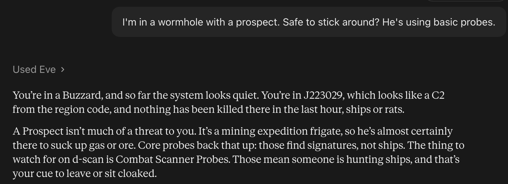

# eve-mcp

A small [MCP](https://modelcontextprotocol.io/) server that gives Claude (or
any other MCP client) live EVE Online data from CCP's ESI API: your own
characters, plus public game data. Everything it does is read-only.

| Tool | What it does | Needs sign-in |
|---|---|---|
| `list_characters` | Who's signed in | no |
| `get_skills` | Skills, levels, SP, unallocated SP (filterable) | yes |
| `get_skill_queue` | Queue order, finish times, when it runs out | yes |
| `get_wallet` | Balance and recent journal entries | yes |
| `get_location` | System, security, station, ship, online | yes |
| `get_assets` | Items by station, most valuable first, with estimated value | yes |
| `can_i_fly` | Missing skills and training time for a ship, module or pasted fit | yes |
| `market_price` | Best buy/sell at Jita, Amarr, Dodixie, Rens or Hek, or all five compared, with the 30-day average | no |
| `item_info` | Group, volume, in-game description | no |
| `system_info` | Security, region, last hour's jumps and kills | no |
| `route` | Gate route with security and recent ship kills for each jump | no |

Files:
- `server.py`: the MCP server. Read this one first: each tool is a short function.
- `eve_common.py`: settings, sign-in tokens, talking to ESI
- `auth.py`: one-off login per character
- `.env`: your app's ID and secret (you make this, git-ignored)
- `tokens.json`: sign-in tokens (made by `auth.py`, git-ignored, keep it private)

Tested with mcp 2.3.0 and httpx 0.28.1, on Python 3.13 (Debian 13) and
Python 3.14 (macOS). It needs Python 3.10 or later. `requirements.lock`
lists the exact versions of every package from the Debian test, if you
want to reproduce it.

## Why MCP

You could give a model the [ESI](https://developers.eveonline.com/docs/services/esi/overview/) documentation and let it make API calls
itself, and for one-off public data (a market price, a route) that works fine. A server has distinct advantages, especially once sign-in is involved:

- **The server holds the credentials.** The model never sees your app's
  secret or your refresh token. It only sees the results of tool calls.
- **The docstrings do the steering.** Each tool's description tells the
  model when to use it, so you don't have to explain ESI in every chat.
- **Results are shaped for a model.** Names instead of numeric IDs, prices
  formatted, long asset lists grouped and cut to a sensible size.
- **It works across clients.** Anything that speaks MCP can use it.
- **The tools are already written.** Having a model rebuild API calls from scratch in every chat is slow and burns tokens.

## Why I built it

There are other EVE MCPs. They have additional tools ranging across the entire ESI API. These may be a better choice for you.

I made my MCP because Anthropic's guidance is that fewer tools work better: the model picks the right one more often and less context is used up.

The ESI API has many more endpoints, but not all need to be sent to a model as part of an MCP. I wanted a frigate, not a battleship: something small and token-efficient that could handle most of the things I need.

And it's fun! I develop MCP servers at work and wanted to apply that knowledge on a game I enjoy.

## Which Claude it works with

The server is a program on your computer, so it only works with a Claude
that can start programs there:

- **Claude Desktop** (the chat app for Mac and Windows): yes. The tools
  appear in ordinary chats and in Projects on that computer.
- **Claude Code**: yes.
- **claude.ai in a browser, and the phone apps**: no. They can't start a
  program on your computer. Uploading these files to a chat or a Project
  doesn't connect anything either.

There are two ways to set it up. Both end in the same place.

## Setup with Claude Code

Paste the prompt below into a new Claude Code session and it does the
work in "Setup by hand" for you. It stops once, for the three things only
you can do: registering the application, typing your secret into `.env`,
and approving the login in a browser.

It connects the server to Claude Code. If you want it in Claude Desktop
as well, add the config from step 6 afterwards.

```text
Set up the eve-mcp server from https://github.com/moconnelldavidson/eve-mcp
on this machine. Follow these steps exactly and in order. If any step fails,
stop and show me the error. Don't work around it.

Rules:
- Never read, print or edit .env or tokens.json, and never ask me to paste
  my client secret into this chat.
- Don't use sudo, and don't change any file in the repository other than
  creating .env.
- On Windows, use "py" instead of "python3", and .venv\Scripts\python.exe
  instead of .venv/bin/python.

1. Find a Python that is 3.10 or later. Try "python3 --version" first,
   then python3.14, python3.13, python3.12, python3.11 and python3.10.
   Use the first one that qualifies wherever the steps below say
   "python3". If there is none, stop and tell me to install one.
2. If ~/eve-mcp already exists, stop and ask me. Otherwise run:
   git clone https://github.com/moconnelldavidson/eve-mcp.git ~/eve-mcp
3. In ~/eve-mcp, run:
   python3 -m venv .venv
   .venv/bin/python -m pip install -r requirements.txt
4. Copy .env.example to .env, then run "chmod 600 .env" (not on Windows).
5. Stop. Tell me to do these three things myself, and wait until I say
   they are done:
   a. Register an application at https://developers.eveonline.com/ with
      the callback URL and scopes from step 1 of README.md. Show me that
      callback URL and scope list.
   b. Open ~/eve-mcp/.env in an editor and fill in EVE_CLIENT_ID,
      EVE_CLIENT_SECRET and EVE_USER_AGENT.
   c. In my own terminal, run the command below and approve the login in
      the browser, until it prints "Saved":
      ~/eve-mcp/.venv/bin/python ~/eve-mcp/auth.py
6. In ~/eve-mcp, run ".venv/bin/python server.py --check". The first line
   must name my character after "Signed in:" and the last line must be
   "o7". If it says "nobody yet", step 5c did not work: stop.
7. Run "claude mcp list". If a server called "eve" is already listed, stop
   and ask me. Otherwise run this, with both paths written out in full:
   claude mcp add --scope user eve -- <path to .venv/bin/python> <path to server.py>
   Then run "claude mcp list" again and confirm "eve" is connected.
8. Tell me to start a new Claude Code session and ask: "Where is my
   character, and when does my skill queue end?"
```

## Setup by hand

Use this if you don't have Claude Code, or would rather see each step.

### 1. Register an EVE application

ESI needs every user to bring their own application. At
https://developers.eveonline.com/ create one with:

- **Callback URL:** `http://localhost:8765/callback`
- **Scopes** (all read-only):
  - `esi-skills.read_skills.v1`
  - `esi-skills.read_skillqueue.v1`
  - `esi-wallet.read_character_wallet.v1`
  - `esi-location.read_location.v1`
  - `esi-location.read_ship_type.v1`
  - `esi-location.read_online.v1`
  - `esi-assets.read_assets.v1`

It gives you a client ID and a secret key.

### 2. Install

From this folder.

Linux or macOS:

```bash
python3 -m venv .venv
.venv/bin/python -m pip install -r requirements.txt
```

On Debian or Ubuntu, if the first command complains that `venv` is missing,
run `sudo apt install python3-venv` and try again.

On macOS, the `python3` that Apple ships is 3.9, which is too old. Check
with `python3 --version`. If you have a newer one installed, use its full
name in the first command, such as `python3.13 -m venv .venv`.

Windows, in PowerShell. If `py` isn't found, install Python from python.org
and tick "Add to PATH".

```powershell
py -m venv .venv
.venv\Scripts\python -m pip install -r requirements.txt
```

The `.venv` folder keeps these packages to this project. In the steps below,
"the project's Python" means `.venv/bin/python` on Linux/macOS and
`.venv\Scripts\python` on Windows.

### 3. Fill in `.env`

Copy `.env.example` to `.env` and paste in the client ID and secret. Set
`EVE_USER_AGENT` to something with a way to contact you (CCP asks API
clients to identify themselves). On Linux/macOS, keep the file to yourself:

```bash
cp .env.example .env
chmod 600 .env
```

### 4. Sign in

```bash
.venv/bin/python auth.py
```

Your browser opens EVE's login. Pick a character and approve. The terminal
should say "Saved" and list any permissions it didn't get. Run it again for
each further character. If you have several, set `EVE_DEFAULT_CHARACTER` in
`.env` to the one the tools should use when you don't name one.

On a machine with no browser, open the printed link on another computer,
approve, then copy the whole address you land on (the page itself won't
load) and paste it into the terminal.

### 5. Check it works

```bash
.venv/bin/python server.py --check
```

It should print who is signed in, where your character is, their ship and
when their skill queue ends, then "o7".

### 6. Connect it to Claude

Both need **absolute** paths to the project's Python and to `server.py`.

**Claude Code:**

```bash
claude mcp add --scope user eve -- /path/to/eve-mcp/.venv/bin/python /path/to/eve-mcp/server.py
claude mcp list
```

`claude mcp list` should show `eve` as connected. The tools only appear in a
*new* Claude Code session: MCP servers are loaded when a session starts.

**Claude Desktop:** open Settings > Developer > Edit Config (the file is
`claude_desktop_config.json`) and add this inside `"mcpServers"`, creating
that section if it isn't there.

macOS:

```json
{
  "mcpServers": {
    "eve": {
      "command": "/path/to/eve-mcp/.venv/bin/python",
      "args": ["/path/to/eve-mcp/server.py"]
    }
  }
}
```

Windows (double backslashes are how JSON writes one backslash):

```json
{
  "mcpServers": {
    "eve": {
      "command": "C:\\path\\to\\eve-mcp\\.venv\\Scripts\\python.exe",
      "args": ["C:\\path\\to\\eve-mcp\\server.py"]
    }
  }
}
```

Then quit Claude completely (on Windows, right-click the tray icon > Quit,
not just closing the window) and start it again.

### On a second computer

Do steps 2 to 6 again there. Don't copy `tokens.json` from one machine to
the other. EVE may replace a sign-in token when it is used, and the copy
left on the other machine then stops working. If both are
in use, whichever refreshes first can leave the other locked out until you
sign in again.

## Things to ask

Once it's connected, ask in plain English. Some questions use one tool:

- "Where is my character, and when does my skill queue end?"
- "What are my drone skills at?"
- "Where did I leave my Buzzard?"
- "What were my last ten wallet transactions?"
- "What is a Stratios, and how big is it packaged?"
- "What's been happening in Tama in the last hour?"

The more useful ones make an assistant combine several:

- "Can I afford a Vexor Navy Issue, and where is it cheapest?"
- "Can I fly a Stratios yet? If not, how long?"
- "Is it safe to fly to Jita from where I am right now?"
- "I'm away from the 20th to the 30th. Will my skill queue last?"
- "What's the most valuable thing I've left somewhere stupid?"
- "Here's a fit. What do I already own, and what will the rest cost?"
  (paste the fit after it)
- "Is now a good time to sell my Tritanium?"
- With your own notes in a Project: "Check my training plan against my
  live skill queue and correct any dates that have drifted."

Item and system names have to be spelled exactly as in the game (capitals
don't matter). With several characters signed in, name the one you mean.
Otherwise the default character is used.

## Use it in a Project

I use it from a Claude Desktop Project set up for EVE, with this folder
added to the Project as a local folder. Claude can then read this README and the
code when something needs explaining, and anything you keep alongside it,
such as a training plan, gets checked against live data.

Left alone, Claude can turn formal when tools are involved, with headings
and a recital of every field. These Project instructions fixed that for me:

```text
Talk to me normally, even when using tools such as MCP servers. Reply in plain prose, without headings or bold, even after tool calls.
Mention only the findings that matter, as you'd tell a friend: this is a video game about spaceships, not a software engineering project.
Use the local MCP server to answer questions rather than guessing, unless you're unable to connect to the environment (i.e. you're on my phone).
```

The last line is there because the Project follows you to the browser and
the phone, but the tools don't.

## Where ESI stops

CCP's API doesn't cover everything, and the server tries to say so rather
than guess. Wormholes are the example that taught me this.



That answer reads well, and the part about kills was wrong. CCP publishes
no kill or jump figures for wormhole space, and an earlier version of the
server reported that gap as zero. A similar answer later got me jumped by
two people in their own home.

`system_info` now gives no activity for a wormhole system. It says the
figures don't exist and points to [zKillboard](https://zkillboard.com/)
for recent kills and [anoik.is](https://anoik.is/) for class, statics and
effects. An assistant with web access can follow those. One without will
at least tell you it can't see.

That is the rule for anything outside ESI: admit the gap and name one
place to look, rather than add a tool for it.

## Security

- **What it can read:** for each character you sign in, their skills and
  skill queue, wallet balance and journal, location, ship, training attributes,
  online status and assets. Nothing else, and only what the seven scopes above allow.
- **What it can change:** nothing. Every scope is read-only and the server
  makes no writes to EVE.
- **Where secrets live:** your app's ID and secret in `.env`, your sign-in
  tokens in `tokens.json`, both in this folder on your machine and both
  git-ignored. `tokens.json` is written with mode 600 (owner only) on
  Linux/macOS. Anyone who gets that file can read the same data until you
  revoke it, so don't share or commit it.
- **Revoking:** remove the application's access at
  https://community.eveonline.com/support/third-party-applications/.
- **Not sandboxed:** like any MCP server run over stdio, this is an ordinary
  program running as you, with your access to your files. Read the code
  before you run it. It's short.

## Adding a tool

Copy one of the short tools in `server.py`, change the ESI path, and start
a new Claude session. The ESI endpoints are listed at
https://developers.eveonline.com/api-explorer. If the new endpoint needs a
new permission, add it to `SCOPES` in `eve_common.py`, tick it on the app,
and run `auth.py` again.

There are small offline tests of the security-status rounding, the fit
parser and the training-time sums:

```bash
.venv/bin/python tests/test_sec.py
.venv/bin/python tests/test_fit.py
```

## If something goes wrong

- **"EVE refused ... (403)"**: the sign-in lacks that permission. Tick the
  scope on your app (step 1), then sign in again (step 4).
- **Login page says invalid scope**: a scope in `SCOPES` isn't ticked on the app.
- **"EVE_CLIENT_ID is missing"**: `.env` isn't there or isn't filled in (step 3).
- **Tools don't appear in Claude**: check the paths are absolute and
  correct, run step 5 to see the error in the terminal, and remember a new
  session (Claude Code) or a full restart (Claude Desktop) is needed. Then
  look at the MCP logs:
  - Claude Code on Linux: `~/.cache/claude-cli-nodejs/<project folder>/mcp-logs-eve/`
  - Claude Desktop on Windows: `%APPDATA%\Claude\logs\mcp-server-eve.log`
- **Claude says it ran the server but got no EVE data**: if the `eve` tools
  aren't connected, Claude may copy the code into its own sandbox and run
  it there instead. That copy has no `.env` or `tokens.json`, and usually
  no route to `esi.evetech.net`. The giveaways are `list_characters`
  returning an empty list and every other tool failing with a network
  error. It tells you nothing about your own setup. Check that `eve`
  appears in the client's list of connected tools, restart the client
  fully, and run step 5 on your own machine.
- **Everything fails after an ESI change**: the server uses
  `https://esi.evetech.net/latest` (`ESI` in `eve_common.py`). If CCP
  changes how the API is versioned, that address may need updating. Raise an issue if I don't get to it quickly.

## Licence

MIT. See `LICENSE`.

Not affiliated with or endorsed by CCP Games / Fenris Creations. EVE Online and all related
names are trademarks of their respective owners.
